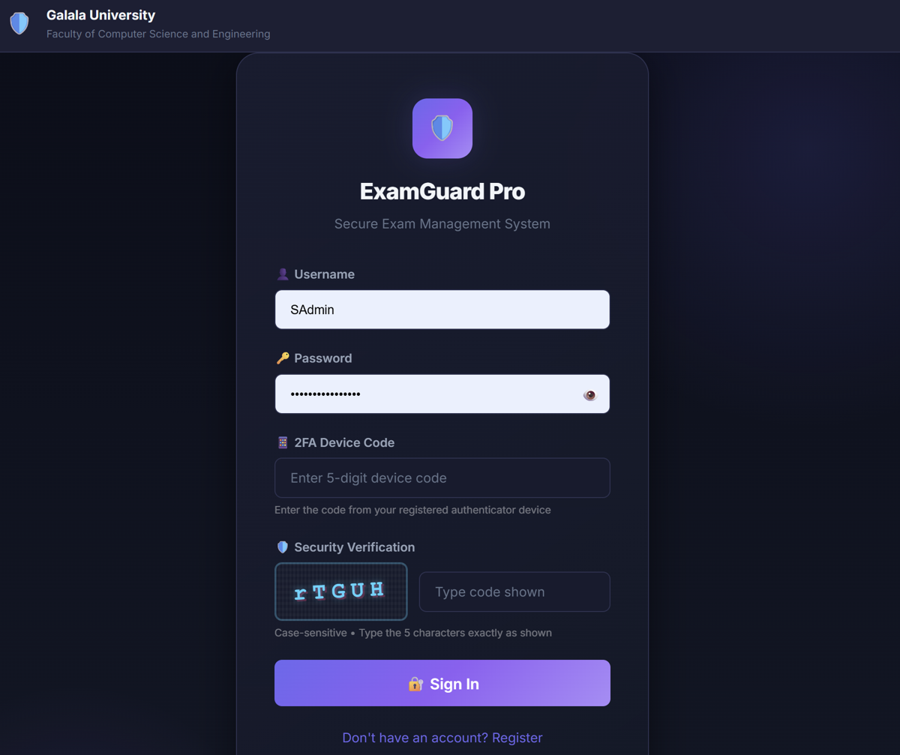

<div align="center">

# 🛡️ ExamGuard Pro

### Secure Exam Management System


*Galala University · Faculty of Computer Science and Engineering · Spring 2025/26*

*CSE243 Secure Programming and Software Engineering course project*

</div>

---

## 📖 Overview

**ExamGuard Pro** is a full-stack web application that digitizes the whole examination lifecycle, from question authoring and exam delivery to grading and audit. Instructors create and publish exams, students take them in a timed and proctored session, and administrators manage users, roles, and the audit trail.

The project is built **security-first**. It follows a Secure Software Development Life Cycle (SSDLC): abuse cases and a risk analysis drove the requirements, the design was threat-modeled with **STRIDE** (Microsoft Threat Modeling Tool), and every control was tested against real attack scenarios. Each security concern lives in its own middleware file.

The same system was delivered for two courses, so the repository contains both sets of deliverables: the **Secure Programming** report, presentation and threat model, and the **Software Engineering** report, presentation and UML/DFD/ERD diagrams.

## 🏆 Highlights

- 🔐 **Defense in depth:** five security layers from the network edge down to the data
- 🧱 **10 security domains** aligned with the OWASP Top 10: authentication, encryption, RBAC, ABAC, CSRF, rate limiting, audit logging, security headers, input validation, anti-cheat
- 🧭 **Threat-modeled:** STRIDE on the data-flow diagram, a full attack-surface threat tree, 7 abuse cases, and a risk matrix
- 🧪 **8 security test cases** covering SQL injection, XSS, brute force, RBAC bypass, cookie flags, encryption, CSRF, and ABAC time gating
- 🧩 **Modular code:** one middleware file per security concern
- 📚 **Fully documented:** reports, slides, threat model, and eight design diagrams are in the repo

## 🖥️ Screenshots

<p align="center">
  
</p>

## ✨ Features

**Students**
- Join exams with an exam code and take them in a time-limited session with a live timer
- Strict exam mode that records suspicious activity and auto-submits on a violation
- Results, grades overview, group and role membership
- Direct messaging with teachers and other users

**Instructors (admin role)**
- Create exams with multiple-choice, true/false, and open-ended questions, with time limits and optional question randomization
- Publish, archive, and share the exam code
- Automatic grading of objective questions and manual grading of open-ended ones
- Results view with the proctoring events recorded for each session
- Student groups, custom roles, and grade overview

**Super admins**
- Create, lock, unlock, and delete users and change their roles
- Network overview and finance reports (time-restricted by policy)
- Audit log viewer for security events

**Proctoring and anti-cheat**
- Records `tab_switch`, `focus_loss`, `copy_attempt`, `paste_attempt`, `right_click`, `fullscreen_exit`, and `suspicious_activity` events
- A session is flagged automatically after 3 tab switches or 5 focus losses
- Strict mode shows a violation notice and auto-submits the exam
- Navigating away from an active exam is blocked server-side (ABAC guard)

## 🔐 Security Design

### SSDLC at a glance

| Phase | What was done |
|---|---|
| Requirements | Abuse cases and a risk analysis matrix |
| Design | Layered defense architecture, STRIDE threat model on the DFD, threat tree and attack surface analysis |
| Implementation | One middleware file per security concern, parameterized queries everywhere |
| Testing | Eight attack-scenario test cases (see below) |
| Demo | Live demos of SQLi, XSS, CSRF, brute force, and session-hijacking protection |

### Abuse cases and countermeasures

| ID | Attacker goal | Countermeasure |
|---|---|---|
| AC-01 | SQL injection on the login form to bypass authentication | Parameterized queries on all database operations (`db.prepare(...).get(username)`); input is never concatenated into SQL |
| AC-02 | Brute-force password guessing | Login rate limiter, account lockout after 5 failures for 15 minutes, CAPTCHA, and a `lockout_until` timestamp on the user |
| AC-03 | XSS payload in registration or form fields | `validator.escape()` on string inputs (except passwords), EJS output escaping, Content-Security-Policy, `httpOnly` cookies |
| AC-04 | Session cookie theft or interception | `httpOnly`, `Secure` (in production), `SameSite=Strict`, 2-hour expiry, and single-session enforcement via `current_session_id` |
| AC-05 | CSRF to submit actions as a logged-in user | Single-use CSRF tokens stored in the `csrf_tokens` table, required on every POST/PUT/DELETE |
| AC-06 | Student leaves the exam tab to look up answers | Proctoring events logged, session flagged on repeated violations, strict mode auto-submits |
| AC-07 | Student manipulates the URL or JWT to reach instructor or admin routes | RBAC `authorize()` on every protected route, with unauthorized attempts written to the audit log |

### STRIDE threat model

| Threat | Description | Mitigation |
|---|---|---|
| **S**poofing | Fake identity or impersonation | JWT sessions, CAPTCHA, a 2FA device-code step (demo implementation), single-session enforcement |
| **T**ampering | Modifying data in transit or at rest | CSRF tokens, input validation and sanitization, parameterized SQL, HTTP parameter pollution protection |
| **R**epudiation | Denying an action | Append-only audit log with user, IP, user agent, and severity; the application only ever inserts audit rows |
| **I**nformation disclosure | Exposing sensitive data | PBKDF2-SHA512 password hashing, AES-256-CBC encrypted chat messages, HSTS and strict headers, generic error messages |
| **D**enial of service | Overwhelming resources | Global and login rate limiting, 1 MB request body limit, account lockout |
| **E**levation of privilege | Gaining unauthorized access | RBAC role hierarchy (`super_admin` > `admin` > `student`) plus ABAC: enrollment status, exam time window, department, and ownership checks |

### Layered defense

| Layer | Controls | STRIDE coverage |
|---|---|---|
| 1. Network | Security headers (HSTS, CSP, X-Frame-Options, nosniff). Run behind HTTPS/TLS in production | Tampering, information disclosure |
| 2. App entry | Rate limiting, 1 MB body limits, input validation and sanitization | DoS, tampering |
| 3. Authentication | PBKDF2 passwords, JWT sessions, CAPTCHA, 2FA step, lockout | Spoofing |
| 4. Authorization | RBAC middleware and ABAC policies | Elevation of privilege |
| 5. Data | Parameterized SQL, output escaping, AES-256-CBC encryption | Information disclosure, tampering |

Middleware order: security headers → logging → body parsing → cookies → HPP → rate limit → sanitize → audit → auth → CSRF → RBAC / ABAC.

### Risk analysis

| Risk | Impact | Likelihood | Mitigation |
|---|---|---|---|
| SQL injection | Critical | High | Parameterized queries |
| XSS (reflected / stored) | High | Medium | Escaping and CSP headers |
| Brute force | High | High | Rate limit, lockout, CAPTCHA |
| Session hijacking | Critical | Medium | HttpOnly / Secure / SameSite cookies, single session |
| CSRF | High | Medium | Per-request CSRF tokens |
| Privilege escalation | Critical | Low | RBAC and ABAC middleware |
| Data breach | Critical | Low | AES-256 and PBKDF2 |

**Password policy:** 8–128 characters with uppercase, lowercase, digit, and special character. Passwords are stored as a salted PBKDF2-SHA512 hash (100,000 iterations).

### Security test cases

Test results as recorded in the Secure Programming report:

| ID | Test | Input | Expected result | Status |
|---|---|---|---|---|
| TC-01 | SQL injection | `username=' OR 1=1--` | Invalid credentials | ✅ Pass |
| TC-02 | Reflected XSS | `<script>alert(1)</script>` | Output escaped | ✅ Pass |
| TC-03 | Brute force | 6 wrong passwords | Account locked | ✅ Pass |
| TC-04 | RBAC bypass | Student requests `/admin` | 403 Access denied | ✅ Pass |
| TC-05 | Cookie flags | DevTools inspection | HttpOnly, Secure, SameSite=Strict | ✅ Pass |
| TC-06 | Encryption | Database password column | Hash blob stored, never plaintext | ✅ Pass |
| TC-07 | CSRF missing | POST without token | 403 Token missing | ✅ Pass |
| TC-08 | ABAC time gate | Finance report outside 09:00–18:00 | 403 Outside hours | ✅ Pass |

## 🏗️ Architecture

```
Browser ──HTTP──▶ Express server
                   │
                   ├─ Security middleware: headers/CSP → logging → body parsing → cookies → hpp
                   │                       → rate limit → sanitize → audit → auth → CSRF
                   ├─ ABAC: exam-navigation guard
                   ├─ Routes: auth · dashboard · exams · admin · chat · audit · people · groups · roles · grades
                   ├─ EJS views (server-rendered UI)
                   └─ SQLite (better-sqlite3, WAL mode, foreign keys ON)

Optional: Redis (refresh-token tracking, email queue) → SendGrid (grade notification emails)
```

## 💻 Tech Stack

| Layer | Technology |
|---|---|
| Runtime / server | Node.js, Express 4 |
| Views | EJS templates, vanilla CSS and JS |
| Database | SQLite via `better-sqlite3` |
| Auth and security | `jsonwebtoken`, `helmet`, `hpp`, `express-rate-limit`, `validator`, `xss-filters`, Node `crypto` (PBKDF2, AES-256-CBC, RSA utilities) |
| Optional services | Redis, SendGrid |

## 🗄️ Database

14 tables: `users`, `exams`, `questions`, `exam_sessions`, `answers`, `exam_enrollments`, `chat_messages`, `audit_logs`, `csrf_tokens`, `custom_roles`, `user_custom_roles`, `student_groups`, `student_group_members`, `proctoring_events`.

The schema is created by `database/init.js`. The MySQL Workbench model is in `database/Relationalmodel.mwb` and the SQL export is in `database/SEP.sql`.

## 📁 Project Structure

```
ExamGuard-Pro/
├── config/
│   ├── database.js           # SQLite connection (WAL, foreign keys)
│   └── security.js           # Password policy, JWT, cookie, rate-limit, CSP, role constants
├── database/
│   ├── init.js               # Creates tables and seeds demo data
│   ├── SEP.sql               # SQL export of the schema
│   └── Relationalmodel.mwb   # MySQL Workbench relational model
├── docs/
│   ├── images/               # README screenshots
│   ├── secure-programming/   # SP report, presentation, and threat model files
│   └── software-engineering/ # SE report, presentation, and UML/DFD/ERD diagrams
├── middleware/               # abac, auditLog, auth, csrf, inputValidator, rateLimiter, rbac, securityHeaders
├── public/                   # Static CSS and JS
├── routes/                   # admin, audit, auth, chat, dashboard, exam, grades, groups, people, roles
├── utils/                    # encryption, tokenManager, redisClient, emailQueue, helpers
├── views/                    # EJS templates (admin, audit, auth, chat, dashboard, exams, grades, people, partials)
├── .env.example              # Environment variable template
├── server.js                 # Application entry point
└── package.json
```

## 🚀 Getting Started

### Prerequisites

- Node.js 20 or newer
- Redis and SendGrid are optional, and the app runs fine without them

### Installation

```bash
https://github.com/smsosa1000/Exam-Management-System.git

npm install
cp .env.example .env
```

On Windows PowerShell, use `copy .env.example .env` instead of `cp`.

Open `.env` and replace the placeholder secrets (`JWT_SECRET`, `AES_KEY`, `AES_IV`, `SESSION_SECRET`) with your own random values. `AES_KEY` must be 64 hex characters and `AES_IV` 32 hex characters. Generate them with:

```bash
node -e "console.log(require('crypto').randomBytes(32).toString('hex'))"
node -e "console.log(require('crypto').randomBytes(16).toString('hex'))"
```

### Run

```bash
npm run init-db
npm start
```

Then open **http://localhost:3000**.

### Signing in

The login form has four steps, and all of them are required:

1. **Username** and **password** (see the demo accounts below)
2. **2FA device code:** this is a demo implementation, so enter `12345`
3. **Security verification:** type the 5-character CAPTCHA exactly as shown (case-sensitive)

### Demo accounts

Created by `npm run init-db`. Sign in with the **username**.

| Role | Username | Password |
|---|---|---|
| Super Admin | `SAdmin` | `SuperAdmin@2025!` |
| Instructor | `Teacher` | `Instructor@2025!` |
| Student | `Student2` | `Student@2025!` |

More seeded accounts are listed in `database/init.js`. These credentials are for local demos only. Change or remove them before any real deployment.

### Scripts

| Command | What it does |
|---|---|
| `npm start` | Start the server |
| `npm run dev` | Start with auto-reload (nodemon) |
| `npm run init-db` | Create tables and seed demo data |
| `npm run reset-db` | Delete the database and recreate it from scratch |

## 📐 Documentation

### Secure Programming (CSE243)

| Document | Location |
|---|---|
| Project report | [`docs/secure-programming/SP-Report.pdf`](docs/secure-programming/SP-Report.pdf) |
| Presentation | [`docs/secure-programming/SP-Presentation.pdf`](docs/secure-programming/SP-Presentation.pdf) |
| Threat model report (PDF) | [`docs/secure-programming/threat-model/threat-model-report.pdf`](docs/secure-programming/threat-model/threat-model-report.pdf) |
| Threat model report (HTML) | [`docs/secure-programming/threat-model/threat-model-report.htm`](docs/secure-programming/threat-model/threat-model-report.htm) |
| Threat model source | [`docs/secure-programming/threat-model/examguard-threat-model.tm7`](docs/secure-programming/threat-model/examguard-threat-model.tm7) (open with the Microsoft Threat Modeling Tool) |

### Software Engineering

| Document | Location |
|---|---|
| Project report | [`docs/software-engineering/SE-Report.pdf`](docs/software-engineering/SE-Report.pdf) |
| Presentation | [`docs/software-engineering/SE-Project-Presentation.pdf`](docs/software-engineering/SE-Project-Presentation.pdf) |
| Context diagram | [`01-context-diagram.pdf`](docs/software-engineering/diagrams/01-context-diagram.pdf) |
| Use case diagram | [`02-use-case-diagram.pdf`](docs/software-engineering/diagrams/02-use-case-diagram.pdf) |
| Activity diagram | [`03-activity-diagram.pdf`](docs/software-engineering/diagrams/03-activity-diagram.pdf) |
| Sequence diagram | [`04-sequence-diagram.pdf`](docs/software-engineering/diagrams/04-sequence-diagram.pdf) |
| State machine | [`05-state-machine.pdf`](docs/software-engineering/diagrams/05-state-machine.pdf) |
| Data flow diagram | [`06-data-flow-diagram.pdf`](docs/software-engineering/diagrams/06-data-flow-diagram.pdf) |
| Relational ERD | [`07-relational-erd.pdf`](docs/software-engineering/diagrams/07-relational-erd.pdf) |
| Class diagram | [`08-class-diagram.pdf`](docs/software-engineering/diagrams/08-class-diagram.pdf) |

Editable diagram sources are listed in [`docs/software-engineering/diagrams/LINKS.md`](docs/software-engineering/diagrams/LINKS.md).

## ⚠️ Known Limitations

This is a course project, and some parts are simplified on purpose:

- **2FA is a demo.** The device code is a fixed value (`12345`), not a real TOTP authenticator.
- **Chat encryption is server-side.** Messages are stored encrypted with AES-256-CBC and a random IV per message, but the server holds the key, so this is encryption at rest rather than true end-to-end encryption.
- **Anti-cheat runs in the browser.** Tab and focus detection can be evaded with a second device or a virtual machine, which the threat tree documents as an accepted residual risk.
- **HTTPS is not terminated by the app.** Run it behind a TLS-terminating reverse proxy in production and set `NODE_ENV=production` so cookies are sent with the `Secure` flag.
- **Rate limits are relaxed for demos.** Tighten them in `.env` and `config/security.js` for real use.

## 👥 Team

| Member | ID | Major |
|---|---|---|
| **Samaa Mohamed Saleh** | 223101629 | CE – Cybersecurity |
| **Omar Khalifa** | 223101614 | CE – Cybersecurity |

**Supervised by Dr. Mohamed Mead**, Galala University

## 📄 License

This project was developed for academic purposes at Galala University as part of CSE243 (Secure Programming) and CSE251 (Software Engineering).
